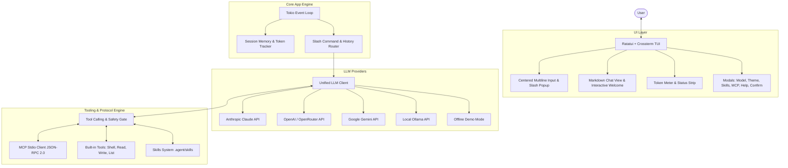

<div align="center">

# ⚡ AGENT CLI

**A high-performance, modern AI agent built in Rust for your terminal.**

Featuring an interactive **Ratatui TUI**, native **Model Context Protocol (MCP)** client, extensible **Skills Engine**, multi-provider LLM support, and **25 curated color themes**.

[](https://www.rust-lang.org)
[](LICENSE)
[](https://ratatui.rs)
[](https://modelcontextprotocol.io)
[]()

<br/>

```text
┌─ ⚡ AGENT CLI  Model: claude-3-7-sonnet │ Theme: Midnight White │ 🔌 2 MCPs │ 🧩 1 Skills ────┐
│                                                                                               │
│   🚀 AGENT CLI — Next-Gen AI Terminal Agent                                                  │
│                                                                                               │
│   Navigate options below with ↑ / ↓ and press Enter, or type a prompt directly below:         │
│                                                                                               │
│     ▶ 🤖 /model    ─ Choose AI model (Claude 3.7, GPT-4o, Gemini, Ollama...)  [Enter to open] │
│       🎨 /theme    ─ Switch color theme (25 curated white/silver dark & light palettes)       │
│       🧩 /skills   ─ Inspect and trigger local Agent skills (.agent/skills)                   │
│       🔌 /mcp      ─ Manage connected Model Context Protocol servers                          │
│       📖 /help     ─ View full cheatsheet & keyboard shortcuts                                │
│       🚪 /exit     ─ Exit the CLI agent gracefully                                            │
│                                                                                               │
├─ 💬 Prompt (Enter to send, Shift+Enter for newline, Tab to complete) ─────────────────────────┤
│                                                                                               │
│    Type a message, press ↑ / ↓ to navigate options, or '/' for slash commands...█             │
│                                                                                               │
└─  INSERT  🪙 Tokens: ~0 │ 🛡️ Confirm: ON │ /help Help │ /model Model │ /theme Theme │ /exit ──┘
```

</div>

---

## 🌟 Key Features

* **🖥️ Rich Terminal User Interface (TUI)**:
  * Built with **Ratatui** and **Crossterm** with raw-mode terminal lifecycle management.
  * Real-time token streaming with animated thinking spinners (`⠋⠙⠹⠸⠼⠴⠦⠧ Thinking...`).
  * Live **Markdown rendering** supporting headers, code blocks with syntax styling, block alerts (`[!NOTE]`, `[!TIP]`, `[!WARNING]`), bulleted/numbered lists, bold, and inline code.
  * Vertically-centered multiline prompt input with generous vertical padding and smooth cursor rendering (`█`).
  * Interactive welcome screen where you can navigate options using **`↑` / `↓`** arrows and launch them with **`Enter`**.
  * Dynamic slash command suggestion popup with arrow navigation and **`Tab`** completion.

* **🧠 Multi-Provider AI Engine**:
  * **Anthropic**: Claude 3.7 Sonnet, Claude 3.5 Sonnet, Claude 3.5 Haiku, Opus.
  * **OpenAI**: GPT-4o, GPT-4o-mini, o3-mini, o1.
  * **Google Gemini**: Gemini 2.5 Pro, Gemini 2.5 Flash, Gemini 2.0 Flash.
  * **Local Ollama**: Llama 3.3, Qwen 2.5 Coder, DeepSeek-R1, Phi-4 (100% private & offline).
  * **OpenRouter & Compatible Endpoints**: Groq, Together, DeepSeek, vLLM, LocalAI.
  * Dynamic switching at runtime via interactive `/model` modal or CLI arguments.
  * **Offline Demo Mode**: Runs out of the box with zero configuration or API keys for instant testing and onboarding.

* **🎨 25 Curated Themes**:
  * **Dark with Pure White & Silver Text**: Midnight White (OLED Jet Black), Obsidian Silver, Titanium Dark, Carbon Silver, OLED Monochrome, and Vesper Minimal.
  * **Iconic Dark Palettes**: Catppuccin Mocha, Tokyo Night, Dracula, Rosé Pine, Synthwave '84, One Dark, Nord, Gruvbox Dark, Cyberpunk Neon, Monokai Pro, Kanagawa Wave, Ayu Dark, Palenight, Solarized Dark, GitHub Dimmed, and Emerald Matrix.
  * **Crisp Light Palettes**: Minimalist Light, Catppuccin Latte, GitHub Light, Paperwhite Clean, Rosé Pine Dawn, Tokyo Night Day, and Solarized Light.
  * Live-updating theme picker modal (`/theme` or `Ctrl+T`) with color swatches and instant full-screen preview.

* **🔌 Native Model Context Protocol (MCP) Client**:
  * Async child-process Stdio JSON-RPC 2.0 client implementation.
  * Connect any standard MCP server (e.g. `@modelcontextprotocol/server-filesystem`, fetch, git, sqlite, postgres).
  * Automatically discovers tools, converts input schemas into LLM function definitions, and executes tool calls.
  * Integrated **safety confirmation prompt** before running any external tool or command (`[Y]es once`, `[N]o deny`, `[A]lways allow for session`).
  * Dedicated `/mcp` dashboard modal to monitor servers and inspect tool schemas.

* **🧩 Extensible Skills Engine**:
  * Discovers skills from `.agent/skills/`, `skills/`, and `~/.config/agent-cli/skills/`.
  * Compatible with standard `SKILL.md` format (YAML frontmatter + markdown instructions + executable script bindings).
  * Dedicated `/skills` modal with split-view to inspect skill instructions and inject them into prompt context.
  * Ships with a built-in `git-helper` skill ready to test!

* **💾 Session Persistence & History**:
  * Auto-saves conversation transcripts to `~/.local/share/agent-cli/sessions/`.
  * Resume previous conversations anytime with `--resume`.
  * History navigation with `↑` / `↓` in empty prompt box.

---

## 🚀 Quick Start

### Installation

Ensure you have [Rust & Cargo](https://rustup.rs/) installed:

```bash
# Clone the repository
git clone https://github.com/aniketshukla1/agent-cli.git
cd agent-cli

# Build optimized release binary and install globally to ~/.cargo/bin
cargo install --path .
```

Now you can run `agent-cli` from any directory!

### Run Immediately

```bash
agent-cli
```

> **Note**: If no API keys are configured, `agent-cli` starts in **Offline Demo Mode**, allowing you to explore the TUI, themes, skills, and slash commands without any setup!

---

## 🔑 Setting Up AI Providers

You can provide API keys via environment variables or inside your configuration file:

### Environment Variables (Recommended)

```bash
# Anthropic (Claude 3.7 / 3.5 Sonnet)
export ANTHROPIC_API_KEY="sk-ant-..."

# OpenAI (GPT-4o, o3-mini)
export OPENAI_API_KEY="sk-..."

# Google Gemini
export GEMINI_API_KEY="AIzaSy..."

# OpenRouter (Access 100+ models)
export OPENROUTER_API_KEY="sk-or-..."

# Local Ollama (Default host is http://localhost:11434)
export OLLAMA_HOST="http://localhost:11434"
```

---

## ⌨️ Shortcuts & Commands

### In-App Keyboard Shortcuts

| Shortcut | Action |
|---|---|
| **`↑` / `↓`** | Navigate welcome screen options / Navigate slash suggestions / Browse history |
| **`Enter`** | Send prompt / Open selected welcome option / Confirm modal selection |
| **`Tab`** | Auto-complete slash command / Cycle welcome options |
| **`Ctrl + P`** | Open interactive **Model Picker** modal |
| **`Ctrl + T`** | Open interactive **Theme Picker** modal with live preview |
| **`PageUp` / `PageDown`** | Scroll chat conversation view up and down |
| **`Esc`** | Close open modal / Clear prompt input / Dismiss suggestions |
| **`Ctrl + C`** | Cancel active generation (first press) / Exit confirmation (second press) |

### Slash Commands

Type `/` in the prompt box to trigger auto-suggestions:

| Command | Description |
|---|---|
| **`/model`** | Open searchable Model Picker (Claude, GPT, Gemini, Ollama) |
| **`/theme`** | Open Theme Picker with live color swatches and instant preview |
| **`/skills`** | Open Skills Manager to inspect and trigger agent skills |
| **`/mcp`** | Open Model Context Protocol dashboard and tool inspector |
| **`/help`** | Open comprehensive cheatsheet & reference modal |
| **`/clear`** | Clear current chat conversation history |
| **`/exit`** or **`/quit`** | Gracefully exit the CLI agent |

---

## ⚙️ Configuration

Configuration is loaded with the following precedence:
1. Workspace-local: `./agent.toml`
2. Global: `~/.config/agent-cli/config.toml`

### Example `agent.toml`

```toml
[general]
# Default theme: "midnight_white", "obsidian_silver", "tokyo_night", "catppuccin_mocha", etc.
theme = "midnight_white"

# Default model: "claude-3-7-sonnet", "gpt-4o", "gemini-2.5-pro", "llama3.3:latest"
default_model = "claude-3-7-sonnet"

# System instruction given to the AI
system_prompt = "You are a helpful, precise, and proactive AI assistant operating in a terminal environment."

# Generation parameters
max_tokens = 4096
temperature = 0.7
stream = true
require_tool_confirmation = true

[providers]
# Keys can also be set via environment variables (recommended)
# anthropic_api_key = "..."
# openai_api_key = "..."
# gemini_api_key = "..."
ollama_host = "http://localhost:11434"

# Model Context Protocol (MCP) Servers
[mcp_servers.filesystem]
command = "npx"
args = ["-y", "@modelcontextprotocol/server-filesystem", "."]

[mcp_servers.fetch]
command = "uvx"
args = ["mcp-server-fetch"]
```

---

## 🎨 Theme Gallery (25 Themes)

Switch themes at any time by pressing **`Ctrl + T`** or typing **`/theme`**:

```text
┌── Dark with White & Silver Text ──────────────────────────────────────────┐
│  • Midnight White    Pure OLED black (#000000) with crisp white & silver  │
│  • Obsidian Silver   Volcanic obsidian (#121214) with sterling silver text │
│  • Titanium Dark     Gunmetal dark (#181a1e) with brushed silver typography│
│  • Carbon Silver     Matte carbon (#161618) with clean silver body        │
│  • OLED Monochrome   High-contrast deep black with pure white monochrome   │
│  • Vesper Minimal    Charcoal dark (#101010) with amber glow and white     │
├── Iconic Dark Palettes ───────────────────────────────────────────────────┤
│  • Catppuccin Mocha  Soothing pastel dark palette                          │
│  • Tokyo Night       Tokyo neon lights inspired palette                    │
│  • Dracula           Classic vampire palette with purples & pinks          │
│  • Rosé Pine         Warm pine, faux fur, and soft rose pastels            │
│  • Synthwave '84     80s retro neon glow with hot magenta & electric blue  │
│  • One Dark          Iconic Atom/VSCode balanced modern dark theme         │
│  • Nord              Arctic, north-bluish clean and elegant palette        │
│  • Gruvbox Dark      Retro groove warm dark palette with earthy tones      │
│  • Cyberpunk Neon    High-energy vibrant neon cyan and hot magenta         │
│  • Monokai Pro       High-contrast classic developer theme                 │
│  • Kanagawa Wave     Japanese ukiyo-e aesthetic with sumi ink              │
│  • Ayu Dark          Deep slate with warm amber and coral orange           │
│  • Material Palenight Deep purple-indigo with lavender accents             │
│  • Solarized Dark    Precision-calibrated dark palette by Ethan Schoonover │
│  • GitHub Dimmed     Modern muted charcoal with crisp GitHub accents       │
│  • Emerald Matrix    Obsidian black with luminous cyber emerald green      │
├── Clean Light Palettes ───────────────────────────────────────────────────┤
│  • Minimalist Light  Crisp, clean high-readability daylight theme          │
│  • Catppuccin Latte  Warm daylight pastel with dark blue-slate typography │
│  • GitHub Light      Official GitHub pure white theme with navy accents    │
│  • Paperwhite Clean  Warm newsprint cream with crisp ink-charcoal text     │
│  • Rosé Pine Dawn    Soft morning daylight variant of Rosé Pine            │
│  • Tokyo Night Day   Pristine daytime variant of Tokyo Night               │
│  • Solarized Light   Warm paper-like cream and cyan daytime palette        │
└───────────────────────────────────────────────────────────────────────────┘
```

---

## 🧩 Creating Custom Skills

Skills allow you to teach the agent custom workflows, instructions, and scripts.

Create a folder in `.agent/skills/<skill-name>/` with a `SKILL.md` file:

```markdown
---
name: code-reviewer
description: Reviews staged git changes for security, performance, and style
version: 1.0.0
author: YourName
---

# Code Reviewer Skill

When reviewing code:
1. Check for unhandled `Result` and `Option` types in Rust.
2. Ensure public functions have doc comments.
3. Check for potential memory leaks or unnecessary `.clone()` allocations.
4. Output constructive, concise feedback in markdown format.
```

Open the agent, type `/skills`, and select your skill to immediately inject its instructions into context!

---

## 🔌 Connecting Model Context Protocol (MCP)

`agent-cli` natively communicates with MCP servers over standard input/output (Stdio JSON-RPC 2.0).

Add an MCP server to your `agent.toml`:

```toml
[mcp_servers.git]
command = "uvx"
args = ["mcp-server-git", "--repository", "."]

[mcp_servers.sqlite]
command = "uvx"
args = ["mcp-server-sqlite", "--db-path", "app.db"]
```

When you launch `agent-cli`:
1. The servers start as managed background child processes.
2. Tools are discovered and exposed directly to Claude / GPT / Gemini.
3. Whenever the model invokes an MCP tool, an **interactive permission modal** prompts you to approve or deny the action.

---

## 🏗️ Architecture Overview



---

## 🛠️ CLI Flags Reference

```text
Usage: agent-cli [OPTIONS] [PROMPT]

Arguments:
  [PROMPT]  Initial prompt to send immediately upon launch

Options:
  -m, --model <MODEL>  Initial AI model (e.g. claude-3-7-sonnet, gpt-4o, llama3.3:latest)
  -t, --theme <THEME>  Color theme (e.g. midnight_white, tokyo_night, obsidian_silver...)
  -r, --resume         Resume the latest conversation session
  -h, --help           Print help
  -V, --version        Print version
```

### Examples

```bash
# Launch with Midnight White theme and Claude 3.7
agent-cli --model claude-3-7-sonnet --theme midnight_white

# One-shot question from the command line
agent-cli "Explain how Rust channels work in 3 bullet points"

# Resume your last conversation
agent-cli --resume
```

---

## 📄 License

This project is licensed under the **MIT License**. See the [LICENSE](LICENSE) file for details.

---

<div align="center">
  <b>Built with ❤️ in Rust for developers who love the terminal.</b>
</div>
